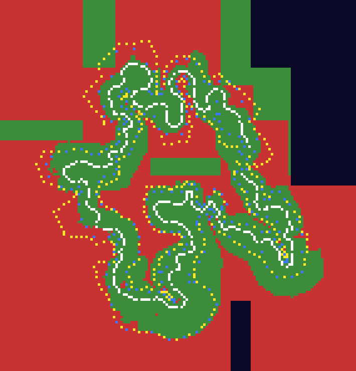

# T2: PS2 solid space outside the driving corridor (Turkey3)

Scripts: `gcoll_map.py` (grid and image), `gcoll_walls_vs_limits.py`, `gcoll_probes.py`; outputs `turkey3-ps2-solid-map.png/.json`,
`gcoll-probes-turkey3.json`. Evidence is static (BSP files and XML); nothing here has been seen in a running game yet.

## Map
Grid step 16 units over the RaceLine bounding box plus 400. For each cell the PC ground height comes from tag100 (first solid contact from
above); PS2 solidity (rule in `T2-BSP-FORMAT.md`) is tested at 3, 30 and 100 units above that height.

White = RaceLine, green = PS2 open, red = PS2 solid at +3, orange = solid only higher, dark = no PC ground, blue and yellow = PC and PS2 outer limit markers.

Of 18,436 cells with PC ground, 11,260 (61%) are solid in PS2 at +3, and the count barely changes at +30 (11,237) and +100 (11,232):
the solid columns are full height over the sampled range. The open (green) region is a corridor hugging the RaceLine.
Solid share by distance from the RaceLine: 0 to 25 units 1.6%, 25 to 50 11%, 50 to 75 22%, 75 to 100 46.5%, 100 to 150 about 60%,
200 to 300 73 to 81%, beyond 300 91%.

Rectangular open patches (axis aligned, disconnected from the corridor) appear in the map; they look like empty leaves of the top-level
splits, not drivable areas (INFERENCE).

## Relation to the limit lists
Marching from the RaceLine toward each outer-limit marker until the PS2 tree is solid (PC ground + 3):
| Marker set | Markers | Wall found | Median wall minus limit distance | Wall within 10 units of the marker | Wall beyond by more than 10 |
|---|---:|---:|---:|---:|---:|
| PC LeftOuterLimit | 110 | 104 | +24.7 | 10 | 71 |
| PC RightOuterLimit | 126 | 122 | +29.2 | 18 | 85 |
| PS2 LeftOuterLimit2 | 230 | 224 | +6.8 | 17 | 106 |
| PS2 RightOuterLimit2 | 209 | 202 | +13.6 | 54 | 107 |
So the solid boundary is not the outer limit line: it usually lies beyond it (median 7 to 29 units, wide spread), sometimes inside it.
The corridor edge is therefore a property of the collision data, not derived from the limit lists.

## Reading and what is not known
- Static reading: on PS2 the space outside a corridor is solid in the collision tree. Whether the game treats it as an invisible barrier,
  and where cars actually stop, is not shown by the data.
- The PC `tag100` has no such shell and relies on its limit lists and `LimitState`.
- UNKNOWN: the engine's handling of the solid exterior at the tree level (for example whether the vehicle code uses these leaves at all
  for car-versus-world contact), and whether the solid belongs to the original BSP source or to a compile default.

## Runtime probes (required by the policy; not performed)
Drive or teleport the car from the road toward the wall at the points below, both on the PC game (Stock) and on PS2 under PCSX2
(`C:\Games\PCSX2_Nightly`, canonical disc). Record whether the car is stopped at the wall position, what the HUD limit state shows,
and take a screenshot. Expected from the data: PS2 stops at the wall; PC keeps going until the outer limit resets the car.

| Probe | Route point (x, z) | Direction | Wall at (x, z) | Wall distance | Nearest PC outer limit, distance | PC ground at road / wall |
|---|---|---|---|---:|---:|---|
| 1 | (3161.5, 168.3) route idx 6 | right of travel | (3225.1, 192.5) | 68 | 61 | 36.2 / 33.3 |
| 2 | (2592.5, 309.6) route idx 84 | left | (2572.7, 221.7) | 90 | 75 | 33.8 / 52.8 |
| 3 | (2387.6, -686.3) route idx 219 | right | (2329.5, -671.5) | 60 | 75 | 35.3 / 61.3 |
Controls: the same route points one third of the way to the wall (expected open on both).
Only three probes survive the filters (straight section, wall on real PC ground within 40 of road height and within 15 to 150 units).
